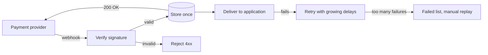

# Pigeon

Reliable webhook delivery: every event verified, stored, delivered once to
your application, and retried until it lands.

> **Status:** in development. The core is being built in public; see
> [Progress](#progress) for what works today.

## The problem

Payment providers notify your application by sending it events
("payment succeeded", "subscription cancelled"). In practice those events:

- arrive **twice**, because the provider retries when it doesn't hear back in time;
- arrive **while your application is down**, and are lost or delayed for hours;
- arrive **out of order**.

The usual result is an order activated twice, or never.

## What Pigeon does

Pigeon sits between the provider and your application:



1. **Verifies** each event's signature and rejects forged ones.
2. **Stores** each event exactly once, even when the provider sends it several times.
3. **Answers** the provider as soon as the event is stored.
4. **Delivers** it to your application in the background, retrying when it is down.
5. **Parks** events that keep failing, so an operator can inspect and replay them.

## Guarantees and limits

- **Stored once:** a uniqueness rule in the database, not an application check.
- **Delivered at least once:** if Pigeon crashes after your application received an
  event but before recording it, the event is sent again. Every delivery carries
  the event ID in a header so your application can ignore a repeat.
- **No ordering guarantee:** each event is forwarded with its original creation
  time; your application decides how to treat a late one.

The reasoning behind each choice is in [`docs/design.md`](docs/design.md).

## Progress

- [x] Project skeleton, PostgreSQL, CI with Testcontainers
- [ ] Receive, verify and store events
- [ ] Background delivery
- [ ] Retries and failed-events list
- [ ] Query and replay API
- [ ] Provider simulator and failure tests
- [ ] Public deployment

## Run it locally

Requirements: Java 25, Docker.

```bash
docker compose up -d
./mvnw spring-boot:run
```

Health check: <http://localhost:8080/actuator/health>

## Run the tests

```bash
./mvnw verify
```

Tests start their own PostgreSQL with Testcontainers, so Docker must be running.

## Tech stack

Java 25, Spring Boot 4, PostgreSQL 17, Flyway, Testcontainers, GitHub Actions.

## License

MIT
